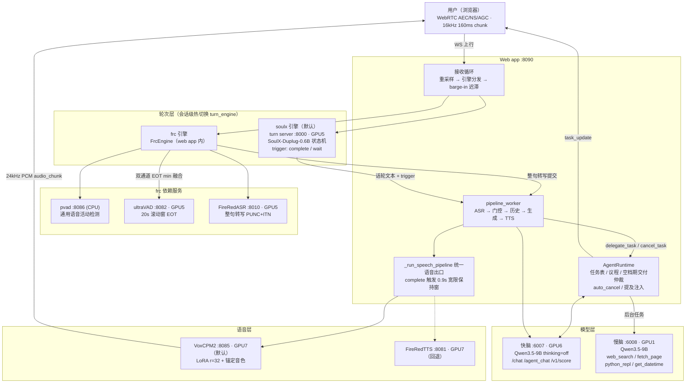
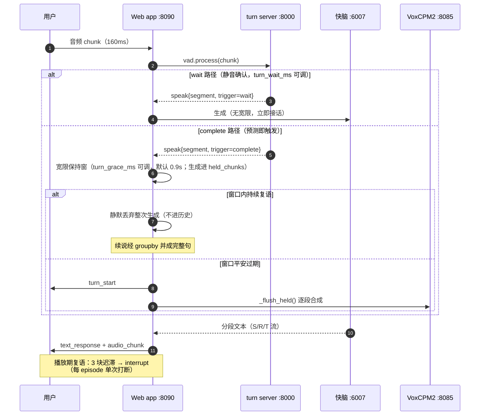
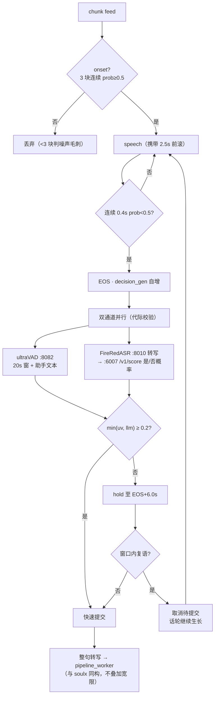
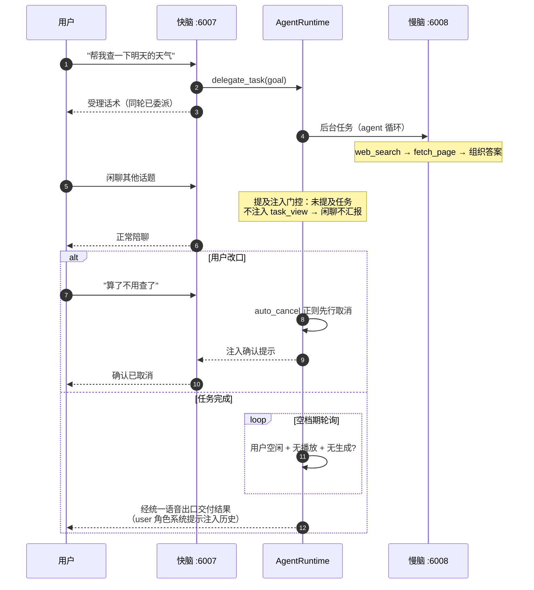
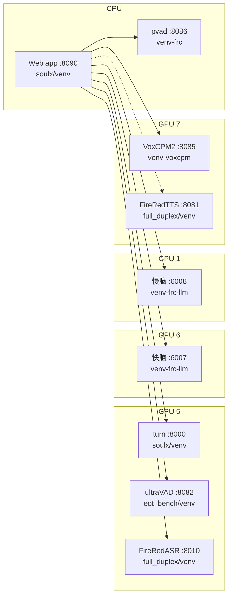

# SoulX-Duplug 系统架构图（Mermaid 版）

> 截至 2026-10-30 · 与 [架构总览-20261030.md](架构总览-20261030.md) 配套。Mermaid 在 GitHub / VS Code / Typora 中直接渲染。

## 1. 总体组件图

## 2. soulx 引擎话轮生命周期（时序）

## 3. frc 引擎决策流（双 EOT）

## 4. 快慢脑 Agent 协作（时序）

## 5. 部署拓扑（GPU / 端口 / venv）

